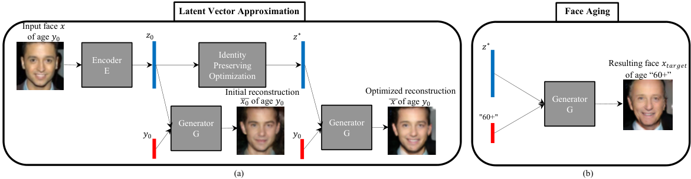
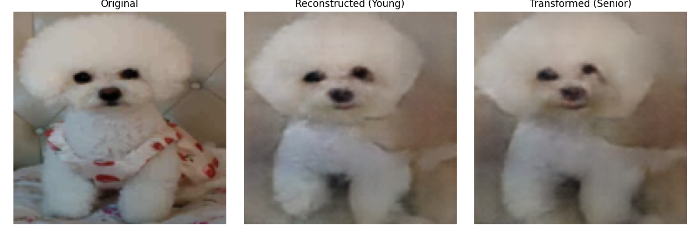
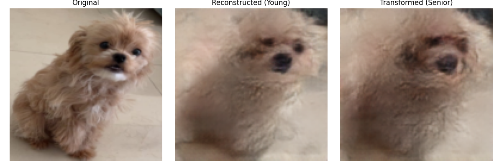
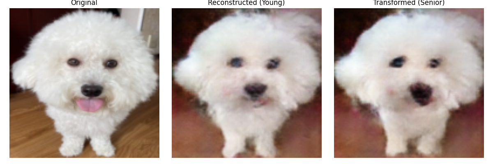

# Dog age transformation with an age-conditional GAN

This repository contains my age-conditional GAN experiments from the [KUBIG dog age transformation team project](https://github.com/KU-BIG/KUBIG_2025_FALL/tree/main/KUBIG%20CONTEST/CV_Team6). For more information about the project, see the team repository.

## Motivation

The goal was to show how a missing dog might look as it aged. This requires changing the apparent age of a photograph while preserving the individual dog's appearance.

## Data

- [AFAC 2023 pet-age recognition dataset](https://aistudio.baidu.com/datasetdetail/225418/0): Used age annotations to label the young and senior conditions.

## My contribution

- Prepared Young and Senior labels from AFAC age annotations, excluding the middle-age range for these experiments.

I adapted the face-aging pipeline of [Antipov, Baccouche, and Dugelay's Age-cGAN (2017)](https://arxiv.org/html/1702.01983v2) to dog photographs. The figure shows the **original paper's pipeline**; the changes below describe my implementation.



*Figure 1 from [Antipov et al. (2017)](https://arxiv.org/html/1702.01983v2). The figure depicts face aging, not the modified dog model.*

### 1. Generator

- **Paper:** Supplies the age label when image generation begins.
- **Our method:** Supplies age information again at later stages of image generation.

### 2. Discriminator

- **Paper:** Broadcasts the age label across the image before processing it.
- **Our method:** Uses a projection discriminator to compare learned features of the dog image with a representation of its age.

### 3. Encoder

- **Paper:** Uses the face image to estimate a latent vector.
- **Our method:** Uses the dog photo and its source age to estimate a latent vector.

### 4. Latent-vector optimization

- **Paper:** Uses trained classifier FaceNet to help preserve identity while refining the latent vector.
- **Our method:** Uses pixel-level and VGG-based visual similarity to refine the latent vector before changing the age label.
  
## Results

The examples below show the original photograph, its reconstruction, and the output under the Senior condition.







*Examples from my KUBIG presentation.*

## Limitations

- **Model:** GAN training can be unstable and susceptible to mode collapse; its image quality can lag behind diffusion-based methods.
- **Data:** Unlike the roughly 120,000 mostly frontal human faces used in Age-cGAN, the dog photos varied in breed, pose, appearance, and background, with only about 16,000 small-dog images available.
- **Age condition:** Dogs show fewer obvious aging cues than people, so changing the age condition often had a limited visible effect.

## Code structure

| File | Role |
| --- | --- |
| [`prepare_labels.py`](prepare_labels.py) | Convert age annotations to two classes |
| [`preprocess_images.py`](preprocess_images.py) | Crop and augment AFAC images once before training |
| [`data.py`](data.py) | Load labeled images |
| [`models.py`](models.py) | Generator, discriminator, encoder, and perceptual features |
| [`train_gan.py`](train_gan.py) | Train either GAN variant (`--variant injected` or `--variant concat`) |
| [`train_encoder.py`](train_encoder.py) | Train the latent initializer on fixed synthetic pairs |
| [`reconstruct.py`](reconstruct.py) | Optimize a latent vector and render age-conditioned output |
| [`notebooks/dog_age_cgan.ipynb`](notebooks/dog_age_cgan.ipynb) | Exploratory experiments and model variants |

## Running the code

Run commands from the repository root. Use a separate virtual environment:

```bash
python -m venv .venv
source .venv/bin/activate
python -m pip install -r requirements.txt
```

For interactive exploration, install `requirements-notebook.txt` instead. The
notebook now includes section headings linking each stage to its Python module.
The Python scripts expose the main workflow; the notebook also preserves optional
plots and alternative experiments. Datasets, checkpoints, and generated outputs
are not committed.

Obtain AFAC separately and place its original images and annotations under `AFAC/`.
Run the image preparation step before training to follow the notebook's workflow:

```bash
python preprocess_images.py --input-dir AFAC/trainset --output-dir AFAC/preprocessed --seed 42
python prepare_labels.py --annotations AFAC/annotations/train.txt --images AFAC/preprocessed --output AFAC/AFAC.txt
python train_gan.py --labels AFAC/AFAC.txt --images AFAC/preprocessed --variant injected
python train_encoder.py --generator-checkpoint runs/injected/G_epoch_250.pth
python reconstruct.py --image path/to/dog.jpg --source-age young --generator-checkpoint runs/injected/G_epoch_250.pth --encoder-checkpoint checkpoints/encoder_concat/E_best.pth
```

`--variant concat` runs the separate concatenated-conditioning GAN experiment.
Encoder training and reconstruction currently use the injected generator; supply
a checkpoint from that variant. The baseline architecture remains available in
`models.py` and the notebook.

The preprocessing script uses the notebook's crop, color jitter, and horizontal
flip while preserving image filenames so labels still match PNG inputs. The
notebook converted PNG extensions to JPG. Encoder training retains fixed latent
and age pairs but generates their images per batch to reduce memory use.
Reconstruction retains the original VGG input normalization; it is an exploratory
implementation, not a claim of validated identity-preserving age progression.

Check Python/notebook syntax and shared definitions without starting training:

```bash
python checks/check_notebook.py
```
