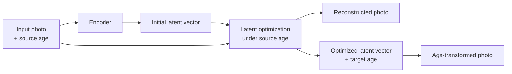

# Dog age transformation with an age-conditional GAN

This repository contains my age-conditional GAN experiments from the [KUBIG dog age transformation team project](https://github.com/KU-BIG/KUBIG_2025_FALL/tree/main/KUBIG%20CONTEST/CV_Team6). For more information about the project, see the team repository.

## Motivation

The goal was to show how a missing dog might look as it aged. This requires changing the apparent age of a photograph while preserving the individual dog's appearance.

## Data

- [DogAge](https://tianchi.aliyun.com/dataset/215529) ([original challenge](https://e-nns.org/icann2019/conference-programme/competitions/)): dog images grouped by age.
- [AFAC 2023 pet-age recognition dataset](https://aistudio.baidu.com/datasetdetail/225418/0): age annotations used to prepare the Young and Senior conditions.

## My contribution

- Prepared Young and Senior labels from AFAC age annotations, excluding the middle-age range for these experiments.
- Implemented age-conditioned generator and discriminator variants, including condition injection and a projection discriminator.
- Trained an encoder to initialize the latent vector, then optimized that vector with pixelwise and VGG-based perceptual losses to reconstruct the input before changing the age condition.

## Results

The examples below show the original photograph, its reconstruction, and the output under the Senior condition.

*Examples from my KUBIG presentation.*

## Discussion

- **Model:** GAN training can be unstable and susceptible to mode collapse; its image quality can lag behind diffusion-based methods.
- **Data:** Unlike the roughly 120,000 mostly frontal human faces used in Age-cGAN, the dog photos varied in breed, pose, appearance, and background, with only about 16,000 small-dog images available.
- **Age condition:** Dogs show fewer obvious aging cues than people, so changing the age condition often had a limited visible effect.

## Code structure

| File | Role |
| --- | --- |
| [`prepare_labels.py`](prepare_labels.py) | Convert age annotations to two classes |
| [`models.py`](models.py) | Generator, discriminator, encoder, and perceptual features |
| [`train_gan.py`](train_gan.py) | Train the conditional GAN |
| [`train_encoder.py`](train_encoder.py) | Train the latent initializer |
| [`reconstruct.py`](reconstruct.py) | Optimize a latent vector and render age-conditioned output |
| [`notebooks/dog_age_cgan.ipynb`](notebooks/dog_age_cgan.ipynb) | Exploratory experiments and model variants |
