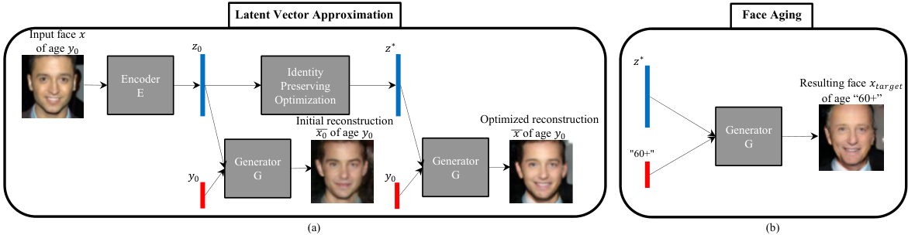
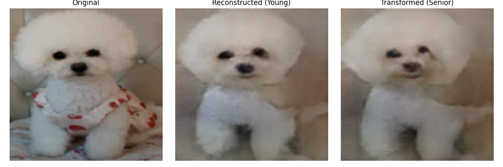
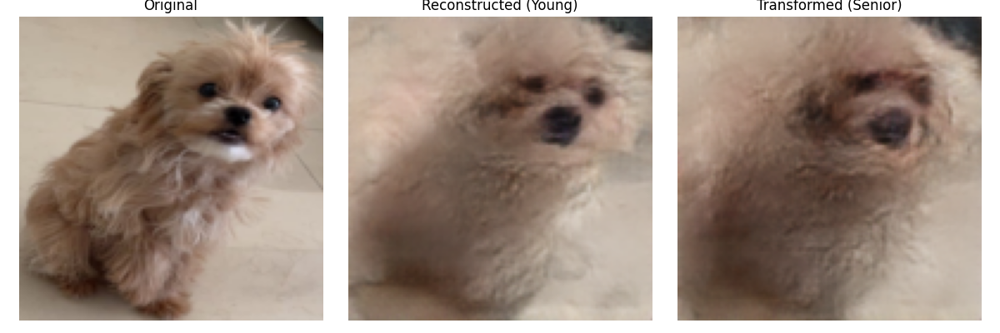
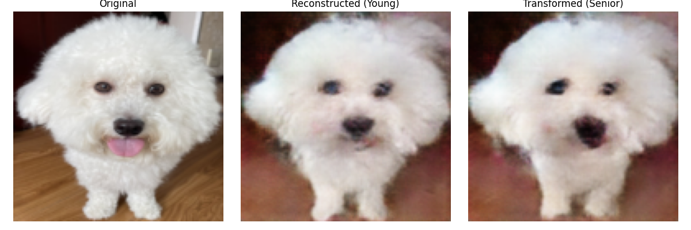

# Dog age transformation with an age-conditional GAN

This repository contains my age-conditional GAN experiments from the [KUBIG dog age transformation team project](https://github.com/KU-BIG/KUBIG_2025_FALL/tree/main/KUBIG%20CONTEST/CV_Team6). For more information about the project, see the team repository.

## Motivation

The goal was to show how a missing dog might look as it aged. This requires changing the apparent age of a photograph while preserving the individual dog's appearance.

## Data

- [AFAC 2023 pet-age recognition dataset](https://aistudio.baidu.com/datasetdetail/225418/0): age annotations used to prepare the Young and Senior conditions.

## My contribution

- Prepared Young and Senior labels from AFAC age annotations, excluding the middle-age range for these experiments.

I adapted the face-aging pipeline of [Antipov, Baccouche, and Dugelay's Age-cGAN (2017)](https://arxiv.org/html/1702.01983v2) to dog photographs. The figure shows the **original paper's pipeline**; the changes below describe my implementation.

*Figure 1 from [Antipov et al. (2017)](https://arxiv.org/html/1702.01983v2). The figure depicts face aging, not the modified dog model.*

### 1. Generator

- **Paper:** Conditions the generator at its input.
- **Our method:** I embedded the age condition and injected it into intermediate features.

### 2. Discriminator

- **Paper:** Conditions the first convolutional layer.
- **Our method:** An initial spatial age-concatenation version overfit and showed mode collapse. I then tested a projection discriminator and late concatenation of an age embedding with image features.

### 3. Encoder

- **Paper:** Estimates an initial latent vector as E(x); age enters the generator separately.
- **Our method:** I replaced an unstable spatial age-map input with an age embedding concatenated to convolutional features before the final fully connected layer.

### 4. Latent-vector optimization

- **Paper:** Uses a FaceNet identity loss to optimize the latent vector.
- **Our method:** I used pixelwise and VGG-feature perceptual losses to construct the latent vector.

## Results

The examples below show the original photograph, its reconstruction, and the output under the Senior condition.

*Examples from my KUBIG presentation.*

## Limitations

- **Model:** GAN training can be unstable and susceptible to mode collapse; its image quality can lag behind diffusion-based methods.
- **Data:** Unlike the roughly 120,000 mostly frontal human faces used in Age-cGAN, the dog photos varied in breed, pose, appearance, and background, with only about 16,000 small-dog images available.
- **Age condition:** Dogs show fewer obvious aging cues than people, so changing the age condition often had a limited visible effect.

## Code structure

| File | Role |
| --- | --- |
| [`prepare_labels.py`](prepare_labels.py) | Convert age annotations to two classes |
| [`models.py`](models.py) | Generator, discriminator, encoder, and perceptual features |
| [`train_gan.py`](train_gan.py) | Train the conditional GAN |
| [`train_encoder.py`](train_encoder.py) | Train the latent initializer |
| [`reconstruct.py`](reconstruct.py) | Optimize a latent vector and render age-conditioned output |
| [`notebooks/dog_age_cgan.ipynb`](notebooks/dog_age_cgan.ipynb) | Exploratory experiments and model variants |
